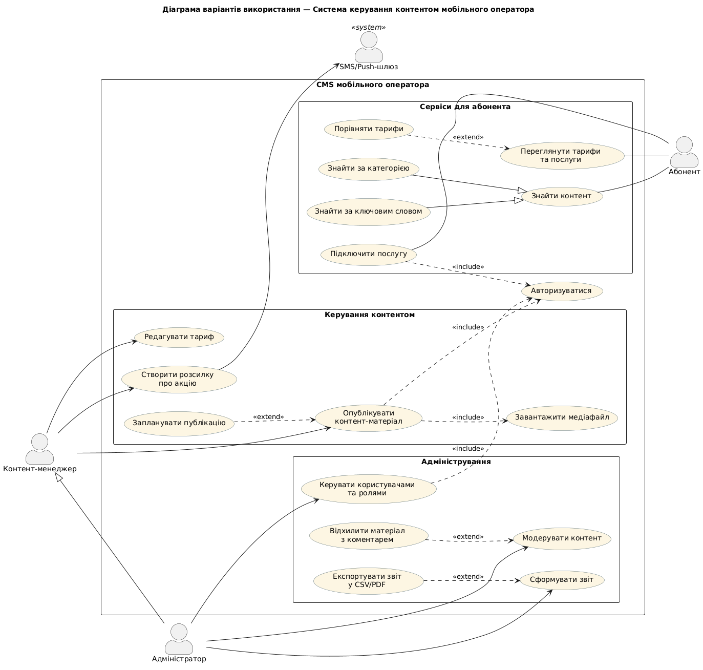
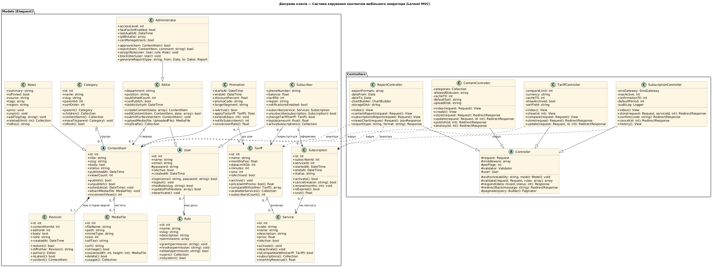

# Архітектура системи: Система керування контентом мобільного оператора

Лабораторна робота №2 — проєктування веб-системи (аналіз предметної галузі, Use Cases, UML-діаграми варіантів використання та класів) як основа для подальшої реалізації на PHP/Laravel.

## 1. Предметна галузь

Мобільний оператор постійно оновлює інформацію для абонентів: тарифні плани, додаткові послуги (роумінг, пакети інтернету, контент-підписки), новини та рекламні акції. Система керування контентом (CMS) дає змогу співробітникам оператора без участі програмістів створювати, погоджувати й публікувати ці матеріали на сайті/в мобільному застосунку, а абонентам — переглядати їх і самостійно підключати послуги.

## 2. Характеристики системи

### 2.1 Призначення та основні функції

Призначення — централізоване керування публічним контентом мобільного оператора та каталогом тарифів і послуг.

1. Створення, редагування та публікація контент-матеріалів (новини, акції, інформаційні сторінки) з історією версій.
2. Ведення каталогу тарифних планів і додаткових послуг (ціни, ліміти, сумісність послуг із тарифами).
3. Модерація контенту: погодження або відхилення матеріалів адміністратором, планування публікації за датою.
4. Медіабібліотека: завантаження зображень і файлів, повторне використання їх у матеріалах.
5. Самообслуговування абонента: пошук контенту, порівняння тарифів, підключення/відключення послуг.
6. SMS/Push-розсилки абонентам про нові акції.
7. Звіти та статистика з експортом у CSV/PDF.
8. Керування користувачами, ролями та правами доступу.

### 2.2 Користувачі системи

| Користувач | Опис |
|---|---|
| **Абонент** | Клієнт оператора: переглядає тарифи, новини й акції, шукає контент, підключає послуги. |
| **Контент-менеджер** | Співробітник маркетингу: створює та редагує матеріали, тарифи, медіафайли, запускає розсилки. |
| **Адміністратор** | Має всі права контент-менеджера, а також модерує контент, керує користувачами/ролями, формує звіти. |

### 2.3 Архітектура

Система будується на фреймворку **Laravel** за патерном **MVC**:

- **Model** — Eloquent-моделі (`User`, `ContentItem`, `Tariff`, `Service`, `Subscription` тощо), що відображаються на таблиці БД через міграції; зв'язки реалізуються методами `hasMany`, `belongsTo`, `belongsToMany`.
- **View** — Blade-шаблони публічної частини (каталог тарифів, новини, акції) та адмін-панелі.
- **Controller** — `ContentController`, `TariffController`, `SubscriptionController`, `ReportController` (успадковують базовий `Controller`), маршрути в `routes/web.php`, доступ обмежується middleware `auth` і політиками (Policies) за ролями.

Додатково: реляційна БД (MySQL/PostgreSQL), файлове сховище (`storage/app/public`) для медіа, черги Laravel Queue для розсилок і запланованих публікацій, CI на GitHub Actions (лаб. 1).

### 2.4 Сценарії роботи

1. **Публікація акції.** Контент-менеджер створює матеріал «Акція», додає зображення, прив'язує до тарифів, надсилає на модерацію; адміністратор погоджує, матеріал публікується (одразу або за розкладом), абонентам іде розсилка.
2. **Підключення послуги абонентом.** Абонент авторизується, переглядає/порівнює тарифи, обирає сумісну послугу, підтверджує SMS-кодом — система створює підписку та списує кошти.
3. **Оновлення тарифу.** Контент-менеджер змінює абонплату/ліміти тарифу або архівує його; зміни одразу відображаються в каталозі.
4. **Формування звіту.** Адміністратор обирає період і тип звіту (публікації, перегляди, підписки), переглядає таблицю й графік, експортує у CSV/PDF.

### 2.5 Логічні сутності та таблиці БД

| Сутність (модель) | Таблиця БД | Основні поля |
|---|---|---|
| User (Subscriber, Editor, Administrator) | `users` | id, name, email, password, phone_number, role_id, is_active |
| Role | `roles` | id, name, slug, permissions (json) |
| Category | `categories` | id, name, slug, parent_id, sort_order |
| ContentItem (News, Promotion) | `content_items` | id, type, title, slug, body, status, category_id, author_id, published_at, views_count |
| Revision | `revisions` | id, content_item_id, editor_id, body, note, created_at |
| MediaFile | `media_files` | id, file_name, path, mime_type, size, alt_text |
| — | `content_item_media` (pivot) | content_item_id, media_file_id |
| Tariff | `tariffs` | id, name, monthly_fee, data_limit_gb, minutes, sms, is_archived |
| Service | `services` | id, code, name, description, price, is_active |
| — | `service_tariff` (pivot) | service_id, tariff_id |
| Subscription | `subscriptions` | id, user_id, service_id, started_at, ends_at, status |

### 2.6 Вихідні дані (output)

1. **Таблиця «Звіт про публікації»** — кількість створених/опублікованих/відхилених матеріалів за період у розрізі контент-менеджерів і категорій.
2. **Графік переглядів** — динаміка переглядів новин та акцій за днями (лінійний графік) і топ-10 матеріалів.
3. **Звіт про підписки на послуги** — кількість активних підписок і дохід за кожною послугою та тарифом (таблиця + стовпчикова діаграма).
4. **Порівняльна таблиця тарифів** — для абонентів (абонплата, ГБ, хвилини, SMS, доступні послуги).
5. **Експорт звітів** у CSV/PDF.

## 3. Use Case у повній формі: «Опублікувати акцію»

Усі три Use Cases (коротка, поверхнева та повна форми) наведено у файлі [use-cases.md](use-cases.md).

**Use Case Name:** Опублікувати акцію

**Scope:** Система керування контентом мобільного оператора (System)

**Level:** User-goal

**Primary Actor:** Контент-менеджер

**Stakeholders and Interests:**

1. Контент-менеджер — швидко й без помилок підготувати та опублікувати акцію до потрібної дати.
2. Адміністратор — опубліковується лише перевірений контент, що відповідає політиці компанії.
3. Абонент — отримати актуальну й зрозумілу інформацію про вигідні пропозиції.
4. Компанія-оператор — залучити й утримати абонентів, збільшити дохід від послуг.
5. Юридичний відділ — умови акції коректні й не порушують законодавство про рекламу.

**Preconditions:** контент-менеджер авторизований у системі та має роль з правом створення контенту; потрібні тарифи вже існують у каталозі.

**Success Guarantee:** акцію збережено в БД зі статусом `published` (або `scheduled`), створено ревізію, матеріал відображається на сайті в розділі «Акції», абоненти цільового сегмента отримали сповіщення, дія записана в журнал.

**Main Success Scenario:**

1. Контент-менеджер відкриває адмін-панель і переходить у розділ «Контент → Акції».
2. Контент-менеджер натискає «Створити акцію».
3. Система відображає форму: заголовок, опис, категорія, дати початку/завершення, знижка, промокод, тарифи, зображення.
4. Контент-менеджер заповнює текстові поля, обирає категорію та період дії акції.
5. Контент-менеджер завантажує банер (include «Завантажити медіафайл»).
6. Система перевіряє формат і розмір файлу, зберігає його в медіабібліотеці та показує прев'ю.
7. Контент-менеджер обирає тарифи, на які поширюється акція, і вказує відсоток знижки.
8. Контент-менеджер натискає «Зберегти та надіслати на модерацію».
9. Система валідує дані, зберігає акцію зі статусом `pending`, створює першу ревізію та сповіщає адміністратора.
10. Адміністратор переглядає акцію та натискає «Погодити».
11. Система змінює статус на `published`, встановлює `published_at` і очищує кеш сторінок каталогу.
12. Система ставить у чергу SMS/Push-розсилку абонентам цільового сегмента.
13. Система показує контент-менеджеру повідомлення «Акцію опубліковано» та посилання на сторінку акції.

**Extensions (альтернативні сценарії):**

- **4a.** Дата завершення раніша за дату початку: система підсвічує поле й не дозволяє зберегти форму; контент-менеджер виправляє дати.
- **5a.** Файл має непідтримуваний формат або більший за 5 МБ: система показує помилку; контент-менеджер завантажує інший файл або обирає наявний із медіабібліотеки.
- **8a.** Контент-менеджер обирає «Запланувати публікацію» (extend): вказує дату й час; після погодження статус стає `scheduled`, і публікацію виконує планувальник Laravel у зазначений час.
- **8b.** Контент-менеджер зберігає чернетку без надсилання на модерацію: статус `draft`, сценарій завершується, роботу можна продовжити пізніше.
- **9a.** Матеріал зі схожим slug уже існує: система автоматично додає суфікс (`-2`) і повідомляє про це.
- **10a.** Адміністратор відхиляє акцію з коментарем (extend «Відхилити матеріал з коментарем»): статус `rejected`, контент-менеджер отримує сповіщення, редагує матеріал (створюється нова ревізія) і повертається до кроку 8.
- **12a.** SMS/Push-шлюз недоступний: розсилка залишається в черзі й повторюється тричі з інтервалом 5 хв; після невдачі адміністратор отримує сповіщення про помилку, публікація при цьому не скасовується.
- **\*a.** У будь-який момент сесія користувача завершилась: система зберігає автозбережену чернетку й після повторного входу пропонує її відновити.

**Special Requirements:** сторінка акції завантажується < 2 с; адмін-панель адаптивна; підтримка української та англійської мов; дотримання вимог доступності (alt-тексти для зображень).

**Technology and Data Variations List:** банер завантажується з комп'ютера або обирається з медіабібліотеки; текст вводиться через WYSIWYG-редактор або Markdown; розсилка — SMS або Push залежно від налаштувань абонента.

**Frequency of Occurrence:** кілька разів на тиждень (≈ 15 % від усіх операцій контент-менеджера).

**Miscellaneous (Open Issues):** чи потрібне погодження юридичного відділу для акцій із знижкою > 50 %? чи показувати акцію абонентам тарифів, що знаходяться в архіві?

## 4. Діаграма варіантів використання

Вихідний код: [diagrams/use-case.puml](diagrams/use-case.puml)

Використані зв'язки:

- **асоціація** — актори ↔ варіанти використання (по три основні для кожного актора);
- **узагальнення** — `Адміністратор` → `Контент-менеджер` (актори), `Знайти за категорією` / `Знайти за ключовим словом` → `Знайти контент`;
- **include** — `Підключити послугу`, `Опублікувати контент-матеріал`, `Керувати користувачами` включають `Авторизуватися`; `Опублікувати` включає `Завантажити медіафайл`;
- **extend** — `Порівняти тарифи`, `Запланувати публікацію`, `Відхилити матеріал з коментарем`, `Експортувати звіт у CSV/PDF`.

## 5. Діаграма класів

Вихідний код: [diagrams/class-diagram.puml](diagrams/class-diagram.puml)

Діаграма містить 19 класів (14 моделей Eloquent і 5 контролерів, включно з базовим `Controller`); кожен клас має щонайменше 5 атрибутів і 5 операцій з типами даних.

| Тип відношення | Приклади | Реалізація в Laravel |
|---|---|---|
| Наслідування | `Subscriber`, `Editor` → `User`; `Administrator` → `Editor`; `News`, `Promotion` → `ContentItem`; контролери → `Controller` | `extends`, single table inheritance за полем `type` / роллю |
| Композиція | `ContentItem` *— `Revision` (ревізії видаляються разом із матеріалом) | `hasMany` + `onDelete('cascade')` |
| Агрегація | `Category` o— `ContentItem`, `ContentItem` o— `MediaFile`, `Tariff` o— `Service` | `hasMany` / `belongsToMany`, частина існує незалежно |
| Асоціація | `User` → `Role`, `Subscriber` → `Tariff`, `Subscriber` → `Subscription` → `Service`, `Editor` → `ContentItem`, `Promotion` → `Tariff` | `belongsTo`, `hasMany`, `belongsToMany` |
